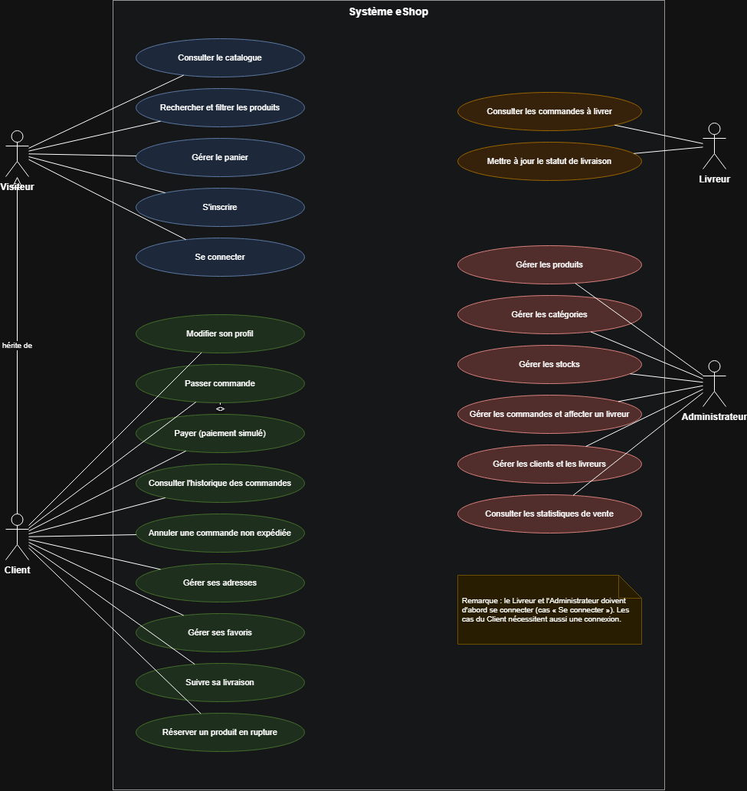

# Cahier des charges : eShop

**Solution web responsive de vente et d'achat en ligne (sujet S01)**

| | |
|---|---|
| Module | Développement Web 1, 1ère année cycle ingénieur |
| Université | iTeam University |
| Enseignante | Salma Bouazizi |
| Année universitaire | 2026/2027 |
| Parcours technologique | Parcours 2 (avec frameworks) |
| Version | 1.0 (18/11/2026) |

---

## 1. Contexte et problématique

Le commerce en ligne est devenu indispensable pour les commerçants qui veulent conserver leurs clients, élargir leur zone de vente et faire face à la concurrence. Une grande partie des achats se fait aujourd'hui depuis un smartphone : un site qui ne s'adapte pas à la taille de l'écran décourage les acheteurs mobiles.

**Problématique :** comment permettre à une boutique de présenter ses produits, de recevoir et de suivre des commandes, et de gérer son activité (stocks, livraisons, statistiques) depuis une application web simple, sécurisée et utilisable aussi bien sur ordinateur que sur smartphone ?

## 2. Objectifs du projet

- Concevoir et réaliser un site de vente en ligne dynamique, relié à une base de données relationnelle.
- Offrir au client un parcours d'achat complet : consultation du catalogue, panier, commande, paiement simulé, suivi de livraison.
- Offrir à l'administrateur un back-office pour gérer les produits, les stocks, les commandes, les clients et consulter des statistiques de vente.
- Offrir au livreur un espace pour traiter les livraisons.
- Garantir une interface responsive conçue d'abord pour le mobile (mobile-first) et un niveau de sécurité de base conforme aux exigences du module.

## 3. Périmètre

**Inclus dans la version 1 :** tous les besoins fonctionnels obligatoires (BF01 à BF27), les besoins non fonctionnels, le tableau de bord de statistiques.

**Extensions (si le temps le permet) :** codes promo, avis clients, facture PDF, notifications par e-mail.

**Exclus :** paiement bancaire réel (le paiement est simulé), application mobile native, suivi de livraison sur une carte en temps réel, messagerie instantanée.

## 4. Acteurs

| Acteur | Description | Actions principales |
|---|---|---|
| **Visiteur** | Personne non connectée, sans compte | Consulter le catalogue, rechercher des produits, remplir un panier, s'inscrire, se connecter |
| **Client** | Utilisateur inscrit et connecté | Tout ce que fait le visiteur, et en plus : commander, payer, suivre ses commandes et sa livraison, gérer ses adresses et ses favoris |
| **Administrateur** | Gérant de la boutique | Gérer les produits, catégories, stocks, commandes, clients et livreurs, consulter les statistiques |
| **Livreur** | Employé chargé de la livraison | Consulter les commandes à livrer, les prendre en charge, mettre à jour leur statut |

Rôles techniques de l'application : `CLIENT`, `ADMIN`, `LIVREUR`. Le visiteur n'a pas de compte : c'est un utilisateur sans jeton d'authentification.

Le diagramme de cas d'utilisation est fourni dans le fichier `cas-utilisation.png` (source modifiable : `cas-utilisation.drawio`) :

## 5. Besoins fonctionnels

### 5.1 Besoins obligatoires

**Comptes**
- BF01 : s'inscrire avec nom, e-mail et mot de passe
- BF02 : se connecter et se déconnecter
- BF03 : modifier son profil

**Catalogue**
- BF04 : consulter la liste des produits
- BF05 : consulter la fiche détaillée d'un produit
- BF06 : filtrer les produits par catégorie
- BF07 : rechercher un produit par mot-clé
- BF08 : filtrer par prix et trier les résultats

**Panier**
- BF09 : ajouter un produit au panier
- BF10 : modifier la quantité ou retirer un produit
- BF11 : afficher le total du panier

**Commande et paiement**
- BF12 : valider une commande avec une adresse de livraison
- BF13 : payer la commande (paiement simulé)
- BF14 : consulter l'historique de ses commandes
- BF15 : annuler une commande non expédiée

**Espace client**
- BF16 : gérer ses adresses de livraison
- BF17 : gérer ses produits favoris

**Livraison**
- BF18 : suivre le statut de sa livraison (client)
- BF19 : consulter les commandes à livrer (livreur)
- BF20 : mettre à jour le statut d'une livraison (livreur)

**Back-office (administrateur)**
- BF21 : gérer les produits (ajout, modification, suppression)
- BF22 : gérer les catégories
- BF23 : gérer les stocks
- BF24 : gérer les commandes et affecter un livreur
- BF25 : gérer les clients et les comptes livreurs
- BF26 : consulter le tableau de bord des statistiques de vente

**Réservations**
- BF27 : réserver un produit en rupture de stock (version simple, réalisée en dernier)

### 5.2 Extensions (bonus)

- BF28 : appliquer un code promo à une commande
- BF29 : laisser un avis et une note sur un produit
- BF30 : télécharger la facture au format PDF
- BF31 : recevoir des e-mails (confirmation de commande, changement de statut)

### 5.3 Règles de gestion

- **RG01** : un e-mail ne peut être associé qu'à un seul compte.
- **RG02** : une commande ne peut être validée que si le stock de chaque produit est suffisant.
- **RG03** : à la validation d'une commande, le stock de chaque produit est décrémenté.
- **RG04** : le total d'une commande est toujours recalculé côté serveur, à partir des prix enregistrés en base.
- **RG05** : une commande suit les statuts `EN_ATTENTE` → `PAYEE` → `EXPEDIEE` → `LIVREE`. Elle peut passer à `ANNULEE` tant qu'elle n'est pas expédiée, et le stock est alors remis à jour.
- **RG06** : un livreur ne peut modifier que les livraisons qui lui sont affectées, et dans l'ordre des statuts.
- **RG07** : un client ne peut consulter que ses propres commandes, adresses et favoris.
- **RG08** : seul l'administrateur peut gérer les produits, les catégories, les stocks, les clients et les livreurs.
- **RG09** : un produit rattaché à des commandes existantes ne peut pas être supprimé définitivement (il est désactivé).

## 6. Besoins non fonctionnels

### 6.1 Interface et ergonomie (responsive)

- **BNF01** : interface responsive conçue d'abord pour le mobile, utilisable sur smartphone, tablette et ordinateur.
- **BNF02** : navigation claire, avec des messages d'erreur et de confirmation compréhensibles, des indicateurs de chargement et des états vides explicites.
- **BNF03** : tableaux et formulaires utilisables sur petit écran.

### 6.2 Sécurité

- **BNF04** : authentification par jeton JWT et gestion des rôles (`CLIENT`, `ADMIN`, `LIVREUR`) côté serveur et côté interface.
- **BNF05** : mots de passe hachés avec BCrypt, jamais stockés en clair.
- **BNF06** : requêtes préparées (JPA) contre les injections SQL.
- **BNF07** : protection contre les failles XSS (échappement par défaut d'Angular, aucune insertion de HTML non maîtrisé).
- **BNF08** : protection CSRF adaptée à l'architecture : l'API est sans état avec un jeton dans l'en-tête `Authorization`, ce qui justifie la désactivation du CSRF de Spring Security.
- **BNF09** : validation des formulaires côté client (Angular) et côté serveur (Spring Boot).
- **BNF10** : CORS restreint à l'origine du frontend, secrets (mot de passe de la base, clé JWT) stockés dans des variables d'environnement et jamais dans le code.
- **BNF11** : aucun numéro de carte complet n'est stocké : le paiement est simulé.

### 6.3 Performance et qualité

- **BNF12** : pagination des listes (produits, commandes) pour garder des temps de chargement raisonnables.
- **BNF13** : API REST documentée (Swagger / OpenAPI).
- **BNF14** : tests automatisés sur la logique métier critique (calcul du total, gestion du stock).
- **BNF15** : code versionné avec Git, avec des commits réguliers.

## 7. Contraintes techniques

| Élément | Choix |
|---|---|
| Frontend | Angular, HTML5, CSS3, Bootstrap, TypeScript |
| Backend | Spring Boot (Java 21), Spring Web, Spring Data JPA, Spring Security |
| Base de données | PostgreSQL |
| API | REST, format JSON |
| Authentification | JWT |
| Outils | Git et GitHub, Docker, Postman, DBeaver, IntelliJ IDEA, VS Code |

## 8. Livrables

- Cahier des charges (ce document) et diagramme de cas d'utilisation.
- Conception de la base de données : modèle conceptuel et script SQL.
- Maquettes des principales interfaces.
- Application complète (code source) avec un jeu de données de test.
- Rapport de projet et démonstration orale.

## 9. Planning prévisionnel

| Semaine | Dates | Objectif |
|---|---|---|
| 1 | 16/11 → 22/11 | Cadrage, installation, conception (besoins, modèle de données, maquettes) |
| 2 | 23/11 → 29/11 | Backend de base, catégories et produits, premier écran Angular |
| 3 | 30/11 → 06/12 | Authentification JWT, rôles, pages protégées |
| 4 | 07/12 → 13/12 | Recherche, filtres, panier, début de la commande |
| 5 | 14/12 → 20/12 | Commande, paiement simulé, espace client, livraison |
| 6 | 21/12 → 27/12 | Back-office et statistiques |
| 7 | 28/12 → 03/01 | Responsive, sécurité, tests, réservation simple |
| 8 | 04/01 → 10/01 | Docker, données de test, rapport, démonstration |

## 10. Risques et solutions

| Risque | Solution |
|---|---|
| Découverte simultanée d'Angular et de Spring Boot | Avancer par petites étapes, tester chaque fonctionnalité avant la suivante, s'appuyer sur la documentation officielle |
| Manque de temps | Prioriser le parcours principal (catalogue, panier, commande, paiement, livraison) et reporter les extensions |
| Incohérences de stock | Transactions (`@Transactional`) et vérification du stock côté serveur |
| Perte de code | Commits quotidiens et envoi régulier sur GitHub |
